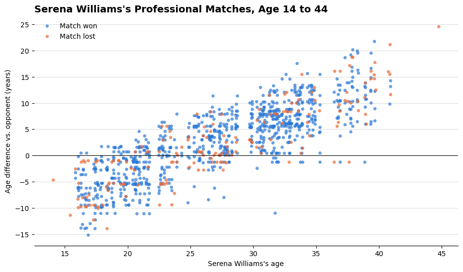
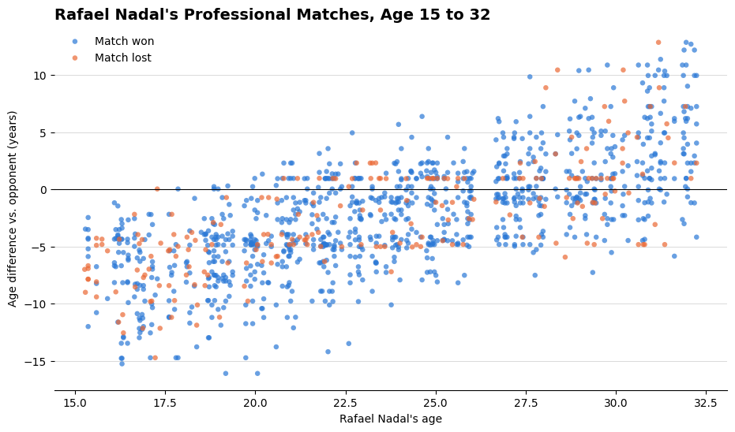

# tennisage

`tennisage` is a Python package that retrieves the career matches of a tennis
player from [tennisabstract.com](https://www.tennisabstract.com) and plots how
the player's age compared to their opponents' ages over their career, like the
New York Times visualization of Serena Williams replicated in HW2.



## Installation

```bash
pip install git+https://github.com/UCB-stat159-f26/hw03-2-reemarafifar72.git
```

Requires Python 3.9+. Dependencies (`pandas`, `matplotlib`, `requests`) are
installed automatically.

## Usage

The package has two public functions:

| Function | What it does |
|---|---|
| `get_player_matches(player_name)` | Downloads a player's matches and returns a clean `pandas.DataFrame` |
| `plot_age_difference(matches, ax=None)` | Scatter plot of the player's age vs. the age difference with each opponent, colored by win/loss; returns the matplotlib `Axes` |

```python
import matplotlib.pyplot as plt
from tennisage import get_player_matches, plot_age_difference

# Serena Williams data and plot
serena = get_player_matches("serena williams")
plot_age_difference(serena)
plt.show()

# Rafael Nadal data and plot
rafa = get_player_matches("Rafael Nadal")
plot_age_difference(rafa)
plt.show()

# an unknown player raises a meaningful error
unknown_player = get_player_matches("GastonSanchez")
# ValueError: Player 'GastonSanchez' not found on tennisabstract.com
# (looked for 'GastonSanchez'). Check the spelling, e.g. 'Serena Williams'. ...
```



### Player names

Names are case-insensitive and may be written with or without spaces:
`"serena williams"`, `"Serena Williams"`, and `"SerenaWilliams"` all work.
Accents and hyphens are handled as well (`"Gaël Monfils"`,
`"Jo-Wilfried Tsonga"`).

The name must match the one tennisabstract.com uses. A few players are listed
under their full name, e.g. Carlos Alcaraz is `"Carlos Alcaraz Garfia"`. If a
name is not found, check the player's page URL on tennisabstract.com.

### The data frame

`get_player_matches()` returns one row per match, sorted by date:

| Column | Description |
|---|---|
| `player` | Player's full name |
| `date` | Tournament start date |
| `year` | Year of `date` |
| `tournament` | Tournament name |
| `surface` | Hard, Clay, Grass, or Carpet |
| `level` | Tournament level code from tennisabstract (e.g. `G` = Grand Slam) |
| `round` | Round, e.g. `R32`, `QF`, `F` |
| `result` | `"W"` (won) or `"L"` (lost) |
| `score` | Match score |
| `opponent` | Opponent's name |
| `opponent_country` | Opponent's country code |
| `opponent_rank` | Opponent's ranking at the time (missing if unranked) |
| `player_age` | Player's age at the match, in years |
| `opponent_age` | Opponent's age at the match, in years |
| `age_difference` | `player_age - opponent_age` (positive = player is older) |

## How it works

For a player such as Rafael Nadal, the package reads two JavaScript files:

- `jsmatches/RafaelNadalCareer.js`: older matches (`var morematchmx = [...]`)
- `jsmatches/RafaelNadal.js`: the player's birth date (`dob`), full name,
  and most recent matches (`var matchmx = [...]`)

The two match lists are combined and de-duplicated. Some players (e.g. Jannik
Sinner) have no career file, so only the recent matches are used. If the second
file does not exist, the player is not on the site, and a `ValueError` is
raised.

Ages are computed as days / 365.25. The files store opponent ages in two
formats: for female players, field 16 holds the opponent's **birth date**
(`YYYYMMDD`), from which the age is computed; for male players, it usually
holds the opponent's **age** directly. The format is detected per row, so both
work.

Note: the data is only as complete as tennisabstract.com's files. For some
players (e.g. Rafael Nadal) the files end before the player's career did.

## Package structure

```
src/tennisage/
├── __init__.py   # exports the two public functions
├── data.py       # get_player_matches() + private helpers for fetching/cleaning
└── plot.py       # plot_age_difference() + private styling helpers
tests/
├── fixtures/     # mock FemalePlayerCareer.js / MalePlayerCareer.js files
├── test_data.py
└── test_plot.py
```

## Running the tests

The tests never contact tennisabstract.com: they use the mock JS files in
`tests/fixtures/`, and the download function is replaced by a fake one.

```bash
git clone https://github.com/UCB-stat159-f26/hw03-2-reemarafifar72.git
cd hw03-2-reemarafifar72
pip install -e ".[test]"
pytest
```

## Personal Reflections

 In HW2 my code was a few scripts that only worked for Serena Williams. Her birth date, the file path, and the plot title were all hard-coded. Turning that into a package forced me to think about what changes from player to player (name, birth date, file format) and what stays the same (parsing, computing ages, plotting). Most of the HW2 logic carried over, but it had to be broken into small, general functions.

The 20-line limit (and the 10-line target for private functions) felt restrictive at first, but it made the code easier to test and debug. Each helper does one thing: normalize a name, parse the JS array, compute ages. That made it obvious where to look when something broke.

I hadn't thought before about tests depending on a live website. If tennisabstract.com is down or its data changes, the tests shouldn't fail. Using the mock JS files and swapping the download function for a fake one let me test the parsing and the error message for an unknown player without making any requests. This only worked because the one function that touches the network was kept separate from everything else.

The data was messier than expected. Women's files store the opponent's birth date while men's files store the opponent's age, and I couldn't simply assume one format per gender: some recent men's matches used birth dates too. I also found that the "Career" file doesn't always contain the whole career. Recent matches live in a second file, and some players (like Jannik Sinner) have no career file at all. And some names don't match what you'd expect: Carlos Alcaraz is listed as "Carlos Alcaraz Garfia." Checking real data, not just the examples in the instructions, was important.